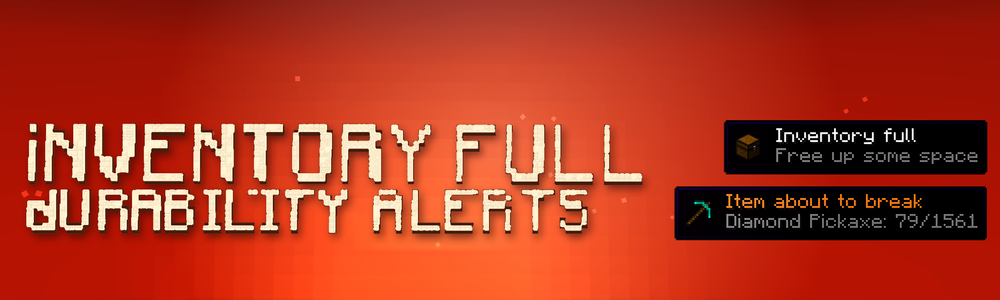
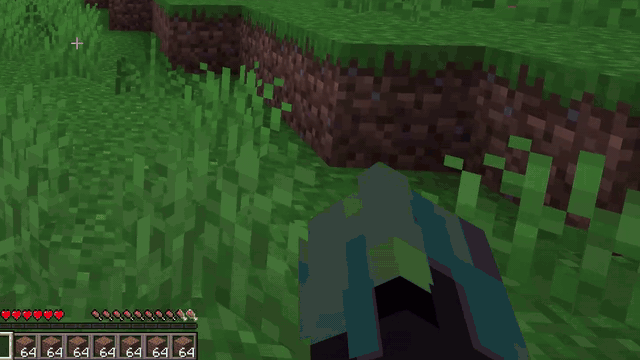

Neat, vanilla-styled notifications in the bottom-right corner — with a sound — when your **inventory is full** or the **item in your hand is about to break**.

## Features

- **Inventory full** — a small notice slides in the moment your last free slot is taken, and slides away on its own or as soon as you free a slot.
- **Low durability** — warns once when the item in your main hand (and optionally offhand) wears down to a set percentage (10% by default). Shows the item, its name and the uses left.
- **Looks like the game** — notices use the vanilla tooltip frame, so they blend into the HUD. Several notices stack neatly.
- **Clearly audible sounds** — a note-block pling for a full inventory, a light anvil clink for low durability.
- **Your own sounds** — any sound from the game, another mod or a resource pack; adjustable volume and pitch.
- **No spam** — one alert per event; nothing on world join, in Creative or Spectator.
- **Client-side only** — works on any server.

## Settings

- In game: **Mod Menu → InvFull & Durability Alerts** (needs [Cloth Config](https://www.curseforge.com/minecraft/mc-mods/cloth-config)).
- Or edit `config/invfull.json` and run `/invfull reload`.
- Preview: `/invfull test full` and `/invfull test durability`.

## Requirements

- [Fabric API](https://www.curseforge.com/minecraft/mc-mods/fabric-api) — required
- [Mod Menu](https://www.curseforge.com/minecraft/mc-mods/modmenu) + [Cloth Config](https://www.curseforge.com/minecraft/mc-mods/cloth-config) — optional, for the settings screen

### NeoForge

Works on NeoForge through [Sinytra Connector](https://www.curseforge.com/minecraft/mc-mods/sinytra-connector) + [Forgified Fabric API](https://www.curseforge.com/minecraft/mc-mods/forgified-fabric-api) (tested on 26.2; Connector is also available for 1.21.1 and 26.1.2). Mod Menu isn't available there, so change settings in `config/invfull.json` and run `/invfull reload`.

Source code: [GitHub](https://github.com/Vivegass/invfull-durability-alerts) · MIT License

---

**По-русски:** аккуратные уведомления со звуком в правом нижнем углу, когда инвентарь заполнен или предмет в руке скоро сломается. Звуки, порог прочности и длительность настраиваются через Mod Menu или `config/invfull.json`. Только клиент.
